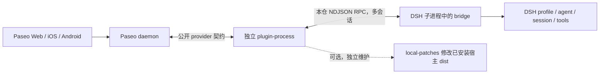
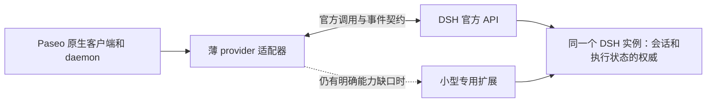

# 架构选择与优化路线（2026-10-31）

状态：调研与方案已完成，尚未实施本文件中的修复、迁移或部署。对应代码基线 `9298c28`；问题和验证证据见 [全量审查](FULL-AUDIT-20261031.md)。

## 1. 决策

**在继续使用 DSH 的运行时、profile 与工具，同时保留 Paseo 的 iOS/Android 原生界面、统一工作区和会话管理这些约束下，保留 direct provider 插件是当前最合适的接入形式。当前这份桥的内部实现仍有明显改进空间，不能把“选对扩展点”当成“所有自定义实现都最优”。**

建议保持 Paseo 插件这个外壳，修复会话和撤回的一致性，同时启动官方 API 的渐进替换：先迁只读能力，再成组迁移控制/事件能力，最后退出不再必要的自有桥模块。继续保留有实际收益的按需 MCP 工具发现，但减少自有传输协议实现和宿主 UI 的重复实现。暂时不整体换成 ACP/SDK，不 fork Paseo 或 DSH，也不为追版本继续扩大宿主 dist 补丁。长期能力替换清单、双轨推进和退出标准见第 9 节。

这里需要修正一个前提：DSH 已有官方 ACP 与 SDK，Paseo 也正式提供 direct/ACP provider 插件扩展点。缺的是**能覆盖本插件完整交互需求的端到端原生集成**，不是两边完全没有公开接口。

## 2. 当前架构及真正的成本

插件不在 daemon 内存中，不能据此观察或修改宿主的 history。当前一个 provider connection 共用一个 DSH 子进程；cwd、模型、MCP 和 systemPrompt 可按 session 处理，环境变量仍属于进程。`local-patches/` 不进入 npm 发布物，其存在不应成为插件正常使用的前提。

基线中有 57 个非补丁生产源码文件、26,329 行源码（排除生成桥、harness 和文档；包含 CLI/生成脚本）。另外有 3 个宿主补丁源码文件、3,493 行，以及 68 个 harness 文件。复杂度已经集中在这些自有职责上：

- 多层 session / turn / request / child 的身份、时序与缓存；
- 文件快照 journal、父子编辑归并、撤回事务与恢复索引；
- 手写 MCP HTTP/stdio 客户端和结果投影；
- 对 DSH 内部服务和 Paseo 宿主投影规则的适配；
- 自绘思考、工具、统计和 jobs 行的状态及跨平台行为。

优化的目标应是减少独立状态和重复协议责任，而不是按文件行数机械拆文件。

## 3. 替代方案对照

| 方案 | 能保留的价值 | 已证实的缺口 / 成本 | 裁决 |
|---|---|---|---|
| 当前 direct provider + DSH profile bridge | Paseo 原生 UI；DSH 工具与 profile；子会话、steer、审批、重放、workflow/goal；自有撤回 | DSH 内部 API 无稳定承诺；本仓承担事务、传输和显示适配 | 保留形式，先修正确性，再缩小桥 |
| Paseo `runAcpProvider()` + DSH 官方 ACP | 标准协议；多会话；模型与思考选择；MCP；单会话取消/关闭；持久会话 resume | DSH 明确面向自动化，省略 transcript replay、`session/load`、modes、commands、plans、elicitation；主要输出 committed 消息而非本插件的即时帧；不会提供等价 DSH 子会话 UI/撤回 | 可做自动化或精简 provider，不替换当前完整体验 |
| direct provider + DSH SDK JSON-RPC | 官方 SDK 协议、durable events/status、子任务通知、resume；alpha 增加提问与单次审批 | rc.5 和 alpha.2 都没有单会话 close / prompt-cancel；resume 不重放历史；不承诺协议版本兼容；没有现成完整撤回/归档/实时流式接口 | 关注其发展，暂不作为唯一底层 |
| direct provider + DSH SessionController/JobController/WorkspaceController 等官方域接口 | rc.5 已有历史/实时事件、投影、prompt/steer/cancel、任务订阅、归档等；可减少自有控制与观察代码 | 依赖具体 composition、调用身份和版本；接口副作用须对齐；不自动解决本仓文件撤回事务 | 长期主线，从现有只读 API 开始逐项替换，不必等 SDK 补齐全部功能 |
| 直接使用 DSH Web/PWA | 不需要桥，DSH 新能力最快可见，alpha 明显改善移动浏览器 | 不保留 Paseo 原生客户端、统一 provider/workspace/终端工作流 | 用户愿意改变工作流时可选，不是等价迁移 |
| fork Paseo 加内置 DSH provider，或 fork DSH | 可改宿主私有能力 | 移动 App、签名分发、双端升级和长期合并成本；不能消除 DSH 版本耦合 | 当前收益不足以支撑 |
| 在其他原生 provider 里直接调用 DeepSeek 模型 | 接入简单 | 更换的是 agent runtime，不能保留 DSH profile、插件、会话和工具语义 | 不满足保持 DSH 的目标 |

Paseo 官方的 [provider 指南](https://github.com/getpaseo/paseo/blob/186c132151ff99889db0572534bd400acdf2cc5b/public-docs/plugins/providers.md) 本身就将“已有 ACP”与“SDK/JSON-RPC/自定义进程协议”分别映射到 ACP 和 direct provider 两条路径。DSH 的 [ACP 约束](https://github.com/deepseek-ai/deepseek-harness/blob/b830ec950faba0a46dda564be3e2d854afed94f1/packages/acp/acp/README.md) 是主动取舍，不能把这些遗漏当成稍加几条 transformer 就能补齐的字段。

## 4. 上游版本趋势与升级判断

查询日期为 2026-10-31。npm dist-tag、GitHub release、源码分支和本机安装分别核对，不能互相替代。

| 对象 | 实际状态 | 对本仓的含义 |
|---|---|---|
| 本机磁盘 | Paseo CLI / plugin SDK `0.14.0`；DSH `0.2.1-rc.5`；本次检查用 Node `22.23.1` | 这是本次库级检查基线；不据磁盘版本宣称所有运行中 daemon/客户端已切换 |
| Paseo npm | `latest=0.14.0`，`beta=0.14.0`；10-27 beta.1 → 10-28 beta.2 → 10-29 正式版 | 当前切 beta 标签不会拿到更高版本 |
| Paseo 主线 | `186c132151ff99889db0572534bd400acdf2cc5b` | 包含尚未进入 0.14.0 对应实现的宿主改动，需单独验证 |
| DSH npm | `latest/next=0.2.1-rc.5`，`alpha=0.2.2-alpha.2` | “latest”本身仍是 rc，不应称为 GA 稳定版；本仓当前适配 rc 线 |
| DSH alpha.2 | 相对 rc.5 ahead 2161 / behind 4，两个分支已分叉 | 不是相邻小补丁，不能只改版本号后跑 doctor |
| 插件上游 | `c642c60` / `0.2.17` | 相对已吸收的 0.2.16，主要收益是 Web 统计行页脚测量；不优先于正确性和移动端状态修复 |

### 4.1 Paseo：扩展面增强，同时重写历史与状态管理

0.12–0.14 的趋势包括 provider/插件能力、文件面板、跨主机编排、会话打开时 MCP/工具注入、回合折叠、移动端导航和长历史性能。对本仓最重要的是**契约、生命周期和历史存储**，语音、编辑器选择等 UI 功能不应自动触发桥重构。

已核关键上游状态：

- [#8080](https://github.com/getpaseo/paseo/pull/8080) 已合主线，恢复被复用子代理的 running 状态；0.14.0 的源码仍忽略 child `started`，主线已经改为 upsert running。继续保持旧 childRunning 补丁退役，等待实际包含修复的发行物。
- [#7675](https://github.com/getpaseo/paseo/pull/7675) 已合主线，将 `history: []` 换成 `PluginSessionHistory`，压缩和释放流式快照。旧 rewind 补丁不能按旧数组结构继续注入；现有 fail-closed 守卫应保留。
- [#8053](https://github.com/getpaseo/paseo/issues/8053) 仍 open；[#8054](https://github.com/getpaseo/paseo/pull/8054) 已关闭、**未合并**。历史文档中“等待该 PR 合并”的假设需要更新，不能把它列为即将交付的修复。
- [#6635](https://github.com/getpaseo/paseo/pull/6635) 仍 open，涉及 timeline retention / full-history replay。关注实际合并版本，不在本地复制另一套宿主历史系统。

当前安装的 plugin 包包含 i18n 类型/实现，但抓取的主线公开文档仍把 runtime translations 标为未发布 API。它是值得复用的方向，尚不足以证明所有 0.14.0 iOS/Android 发行物都已支持；采用前要核对 daemon 与各客户端发行物，并保留旧宿主 fallback。

### 4.2 DSH：rc.5 改动小，alpha 有确定的破坏性接口变化

[rc.5 发布说明](https://github.com/deepseek-ai/deepseek-harness/releases/tag/dsh-v0.2.1-rc.5) 主要是思考显示优化。[alpha.2 发布说明](https://github.com/deepseek-ai/deepseek-harness/releases/tag/dsh-v0.2.2-alpha.2) 则涉及 SDK 提问/审批、独立 session API、异步 projection registration、工具按步骤激活、模型选择时机、Cordis timer、PTC 与官方 bundle 导出等。

本次下载了相关 npm 原包，仅解包比较 `lib`，没有安装或启动 alpha：

- 8 个直接依赖中，`dsh-agent`、`dsh-llm`、`dsh-attachment`、`dsh-tools` 的运行时/类型文件有变化；brand/cmdline/subprocess 与本次解析的 schemastery 运行时文件未变。详细文件摘要见证据目录的 `alpha-package-diffs.json`。
- **确定的迁移阻断：`installModelSelection(ctx, selectionRef)` 变成 `installModelSelection(ctx)`。** rc.5 会从第二参读取 mutable selection，并介入 prompt assembly / request；alpha 仅安装 pre-step 的模型切换提示。新真实模型选择由 `agent.model.current()/select()` 持有。现桥 `server.js:3184` 仍传第二参，`:1148` 仍只改 `selection.current`，在 alpha 不再具有原来的路由作用。
- 该函数仍存在且仍是 function，所以当前仅检查导出存在性的 `dsh-api-contract-check` 不能发现这个变化。应补“切换后真实请求使用所选路由”的行为合同。
- **不要误判另一项变化：** alpha 的 `snapshot(session, keys)` 仍同步，registry `stateOf` 保留为 deprecated；异步的是 registration / retained handle。不能声称当前 P003 的同步 snapshot 读取必然坏掉。
- alpha npm 明确要求 Node `>=24.9.0`，与本次环境的 `22.23.1` 不同。Node 运行时也是迁移输入，不能只升级 DSH。
- alpha SDK 已补 native user questions 与单次 approval，但请求方法清单仍没有 `session/cancel` / `session/close`；其 README 明确承认此限制。

因此现阶段继续使用已验证的 rc.5。建立 alpha 的旁路验证环境、准备适配，不把生产 profile 当作试验场。当前没有足够证据承诺 alpha 的全链路可用性。

## 5. 目标结构：保留外部契约，缩小内部适配面

以下是职责边界，不要求一次性把全部文件迁移到新目录。

| 边界 | 唯一负责的事实 | 需要消除的重复状态 |
|---|---|---|
| Paseo provider adapter | 请求准入、对外 session/turn 身份、协议事件 | 多条 open 路径各自判断 owner；ready 后才发现实例已关闭 |
| DSH runtime adapter | 指定受支持版本的 create/resume/model/plan/permission/projection | 散落的 `ctx.get()` 与不同路径对同一 API 时机的假设 |
| Session / turn lifecycle | 真正新回合、steer、终态、代次失效 | 预留 turnId 被当成回合已开始；崩溃覆盖历史终态 |
| Rewind transaction | journal 顺序、派发因果、冻结点、恢复与清理 | 先形成过期文件计划，再异步允许写入；恢复前清掉唯一索引 |
| MCP gateway | 按需工具发现与模型可见输出 | 自己再维护残缺的取消/结果/握手语义 |
| Client rendering | 无损呈现、交互和平台体验 | mapper 丢 error；把计划内容当结果；依赖额外帧才能落定 |

桥协议应增加显式的版本/feature 握手和结构化错误。现有 `serverInfo.version='0.1.0'` 不能代替兼容协商。未知能力应有可诊断的拒绝；客户端和桥不能根据某段错误英文判断是否值得重试。协议迁移需保留一个明确、有限的兼容窗口，不能悄悄混用两套流式通道。

MCP 方面优先评估复用 DSH 的受支持 client 入口或在构建时 bundle 成熟客户端。安装不跑脚本、桥用 base64 分发，都不意味着永远不能预先打包依赖。若评估不合适才继续手写，但需完整承担 signal、structuredContent、分页、server requests、协议版本和字节预算。

## 6. 实施路线与验收条件

### 阶段 A：修正确性，建立可信验证入口

建议拆成可单独审查的提交/PR，不做跨模块大重写。

| 工作包 | 对应问题 | 交付与退出条件 |
|---|---|---|
| A1：open/close 事务 | S01 | 在关闭任何 holder 之前取得双身份事务 claim；close 使 open 失效；发布 ready 前验证实例身份。不同 provider id/同 persistence、close-during-open、同池 sibling 都有正反对照 |
| A2：持久快照顺序 | BR-01 | root journal 的捕获序号跨进程单调且先后顺序可解释；保留并行捕获/逆序提交语义。旧已错序 journal 不强行猜顺序，保留对象并给人工恢复边界 |
| A3：撤回冻结与子任务因果 | BR-02/03/04 | 最终文件计划产生于正确冻结点；已在飞的 child commit 纳入恢复；未处理记录不能被 prune。旧 child 派孙不借根最新消息冒充来源；路径对象变化拒绝恢复并保留备份 |
| A4：验证入口与诊断 | D1/D2、测试体系问题 | doctor 使用真实 YAML 对象，probe 不把鉴权/额度故障转成能力结论；route-test 的终态和退出码可信；新增缺陷用例进入 PR required checks |

A2/A3 要先定义 journal 升级、部分成功和失败保留策略。可选方案是 flush 后等待被撤 child 收敛，再重算最终文件计划；另一个方案是正式 root-scoped barrier。选型必须同时满足“未经验证不取消旧任务”“失败不丢恢复证据”“不同 root 不互相锁住”。只移动一次 `planRestore()` 调用不足以完成该工作包。

### 阶段 B：统一状态与工具结果语义

| 工作包 | 对应问题 | 退出条件 |
|---|---|---|
| B1：配置权威 | S02/S03/S04、BR-05 | catalog/session.config 来自同一能力源；后端回执后才提交状态；新模型与 effort 同步；queued false 与 true 对称；多字段部分成功有明确结果 |
| B2：回合/子会话 | S05/S06/S07 | 两回合统计各自准确；steer 不重置同回合；已结束 child 不被后续崩溃改写；无 label 的直接/flush 路径共用一个开门条件 |
| B3：MCP 与图片 | BR-06/07/08 | 取消贯穿 caller→transport→结果处理且不杀共享进程；structured output 可被模型读到；取消后不写图片；缓存目录与 staging 身份可靠 |
| B4：客户端保真 | C1/C2 | write/edit 错误原因在过 schema 后仍可见；增长和 complete 同帧也会落定；成功、取消、回放和卸载都有对照 |
| B5：调用者身份 | S08 | 两会话通过无副作用的 CLI caller fixture 各读到自己的身份，B 不得沿用 A；MCP 的现有正确身份不受影响。先证实会话级 shell env 扩展点，无法保证时明确拒绝依赖错误 self 的路径 |

不要把 B5 简化成“按 env hash 多起几个进程”：多进程还需要统一 archive registry 一致性、同 native session 的唯一 owner 和写租约。保留单池的性能收益与隔离收益应有可量测的取舍。

### 阶段 C：交付和兼容性工程

1. 增加独立 `push/pull_request` 检查；上游同步只产生候选 PR。当前唯一 schedule/workflow_dispatch 在上游无新提交时直接退出，不能给普通本地改动提供测试保证。
2. 建立机器可读的测试清单：运行环境、是否用模型、是否写 profile、是否需宿主、超时、owner 模块。由同一入口准备编译树/假桥并输出 JSON 结果，减少手工复制和命令漂移。
3. 固定发行兼容矩阵：受支持的 Paseo daemon/SDK/客户端版本、DSH/Node/profile、桥协议/资产 hash。先覆盖实际使用的 0.14.0 + rc.5，再决定最低 0.9.2 的保留成本。不能仅因 devDependency 为 0.14 判旧版一定坏，也不能仅因类型存在宣称各 App 已支持。
4. bootstrap 改为完整代际暂存、校验、再切换，失败保留旧桥。当前先删再逐文件写的方案需要明确安装失败恢复路径。
5. 可选宿主补丁只替换自身区块；发现额外 tail 语句或宿主历史结构改变就 fail closed。每个补丁记录退出条件；不得把永久注入当默认发行方案。
6. 更新 README/OVERVIEW/ADOPTION 的进程模型、已发布版本、图片和重载说明。历史审查文档保留时间语义，新增索引标明哪些问题已修、哪些 PR 已关闭、哪些仍待验证。
7. 上游吸收建立提交台账：采纳、等价替代、拒绝及原因、验证。0.2.12–0.2.16 的吸收提交只有一个 parent，Git 不知道已经吸收哪些内容；不能反复用版本号代替这份记录，也不能未审语义便用 ours 合并掩盖差异。

### 阶段 D：性能与移动端，以测量决定投资

先收集基线，再决定聚合、分页、裁剪或分池：

- 10/100/200 agents、1/多客户端时的 jobs RPC 总量、并发数、后台唤醒与延迟；每 4 秒/agent 的当前策略约为 N/4 RPC/s，再乘客户端数，这只是推算，不是实测耗电结论。
- 长历史 1/10/50 MiB 下的打开时间、首 delta、重放峰值 RSS、IPC 字节、在飞帧/孤儿桶、事件循环延迟；明确每连接与每会话预算。
- iOS/Android 原生的 390px 紧凑布局、动态字体、浅深主题、长路径/错误/diff、思考末帧、jobs、弱网与前后台切换；Web 截图和 JSX 数值断言不能代替这些门。
- reduced-motion、后台暂停动画/轮询、当前 agent 必覆盖的分页/订阅策略；不能把列表第一页当全体。

优先减少不可见 agent 的轮询和无必要的整行接管，保留用户需要的 DSH 展示能力。先做到可读、可点、可恢复、终态正确，再做字号/贴靠。上游 0.2.17 的 Web footer 测量不作为移动端优先工作。

### 阶段 E：独立验证下一代 DSH 版本

在隔离 Node 24.9+ / DSH alpha 环境中，先适配 `agent.model`，再验证 model switch、retry 时的固定路由、plan 恢复、取消/close、projection readiness、tools lifecycle、MCP、父子撤回。此阶段不连接生产会话，也不更改生产 profile。

官方 API 替换与 alpha 升版分成两条轨道：第 9 节的只读迁移从阶段 A 并行启动，使用当前 rc.5 已有能力；无须等待阶段 D 的 UI/性能工作完成，也不以 alpha 升版为前提。SDK 只有在提供会话级取消/关闭、稳定事件/恢复接口且覆盖必要能力后，才重新评估让它独自承接整个底层。

## 7. 发布和回退

每个修改包都保留明确回退点；修改 `dsh-bridge/` 后重生成 `bridge-assets.ts`，先跑资产新鲜度，再运行插件级测试。发布门应分成四层：

1. 安装/配置/版本完整性；
2. 离线与假桥的协议、时序和错误语义；
3. 隔离真实 DSH 的模型回合、取消恢复、父子文件撤回、重开；
4. 原版/补丁宿主与目标移动客户端的交互验收。

本次完成的是审查、调研与可执行方案。没有执行上述修复，没有升级 Node/DSH/Paseo，没有合并上游、重启 daemon、启动 DSH 真实模型测试回合、打补丁、push 或发布。实施时继续遵守仓库既有的真机确认与产物发布顺序。

## 8. 重新评估架构的明确触发条件

以下是扩大迁移、进一步移除传输或专用扩展的触发条件；当前已有官方 API 的能力，按第 9 节先行替换。

- DSH ACP 增加并实际维护等价的交互、实时帧、历史恢复与子会话能力；
- DSH SDK 补齐 session cancel/close 和兼容承诺，能完整覆盖本插件的持久/并发需求；
- DSH 发布可在轻量 profile 稳定消费的 SessionController 域接口；
- Paseo 公开历史替换/重放 turnId、child permission/usage、native tools 与 usage identity 等所需契约；
- 用户愿意放弃 Paseo 原生客户端，改用 DSH Web 的工作流。

在这些条件变化前，正确方向是**保留插件边界、减少自有责任、用行为门禁管理上游变化**。

## 9. 长期主线：逐项用官方 API 替换自有桥

本节根据用户关于“长期逐渐替换桥”的追问补充。此前将 SessionController 试验放在路线图后段，容易把“短期先修正确性”理解为“长期维持全部自有实现”。现在明确：**官方能力迁移是持续主线，可与 P1 修复并行；每完成一批迁移，都应删除一批已被接替的代码和状态。**

### 9.1 最终希望保留什么

Paseo 插件负责两套产品之间必需的身份/事件/界面转换。DSH 自己负责会话执行、工具、持久状态和原生操作。专用扩展只承接确实没有等价官方接口的能力，并为每一项写退出条件。若这些缺口全部被覆盖，自有 `dsh-bridge/` 可以进一步退役；不要求保留当前体量或当前 NDJSON 协议。

这里的 API 指 DSH 的**会话、任务、事件与工作区接口**。单独接模型推理 API 不能替换 agent runtime 的这些职责。

### 9.2 官方服务端 API 与 SDK 必须分别判断

本次补查的是本机官方 npm 包 `0.2.1-rc.5` 的 README、导出类型和实现，而不是推测未来版本。

| 已存在的官方能力 | 具体接口 | 可以接替本仓什么 | 迁移前必须核对 |
|---|---|---|---|
| 会话列表与冷读取 | `SessionController.list/inspect/page/projections`，`SessionQuery` | `paseo/sessions/history/projections` 中的手工读取、状态装配、部分重放数据取得 | 不复活只读会话；分页/seq/迁移态；保留本桥 rewind 与 DSH compaction 的不同投影规则 |
| 实时事件与状态 | `SessionController.follow/control`；`follow` 有 `assistantStream: true` | 部分自有瞬时帧订阅、断线基线、重连/缺口处理 | attempt、dense index、durable 结算、父子地址；Paseo 的 turnId/messageId 转换仍由适配器负责 |
| 后台任务观察 | `JobController.list/follow` | `paseo/jobs` 的轮询式数据读取，任务输出读取的部分自有逻辑 | owner/unowned 可见性；不消耗模型读取游标；取消订阅/输出 offset；空列表与不可用状态分开 |
| 后台任务停止 | `JobController.kill` | 将来 jobs UI 的用户停止操作 | 使用用户停止语义，保留向 owning agent 的完成通知；不能拿模型自己的 job_kill 代替 |
| 会话控制 | `SessionController.create/prompt/updateQueue/cancel/selectModel` | 自有 create/resume/control 和部分 config 操作 | 实际 sessionId、writer lease、重复请求、queue/steer、回执与终态、默认模型副作用；按生命周期组迁移 |
| 工作区归档 | `WorkspaceController.archiveSession/unarchiveSession/follow` | 对 registry 的直接操作和部分状态同步 | 工作区身份、父子归档、活动任务处理、重连后的权威状态；不可只对函数名做对应 |
| 工具协议 | DSH 原生 MCP client 或构建时打包成熟客户端 | 自有 HTTP/stdio 客户端 | 保留按需 schema 的 gateway 产品价值；signal、structuredContent、图片和权限语义等价 |

**SDK 缺少 session cancel/close，不代表 DSH 官方服务端 API 没有 cancel。** rc.5 的 `SessionController.cancel` 已明确只取消指定 live turn、保留 pending inbox，并返回 `{accepted:true}`。该回执不是回合已经结束的证明，仍需观察终态；它也不等于释放 session/写租约。外部 DSH 服务模式下，关闭 Paseo 视图通常应释放观察/连接，DSH runtime 的回收由其 owner 管理，不能用 cancel 假装 close。

现有代码已经有渐进复用的起点：`dsh-bridge/lib/session-projections.js:5` 优先调用存在的 `sessionController.projections()`，仅在当前 composition 没有 controller 时使用底层查询服务。下一步是把这种复用变成有版本和验收条件的能力迁移，而不是继续增加互相独立的 fallback。

### 9.3 已确认的语义差异，不能机械接线

1. **切模型还会写默认值。** rc.5 `SessionController.selectModel()` 除修改该会话，还调用 `agentDefaultModel.saveSelection(selected)`。Paseo 的单会话模型配置不能未经设计变成修改全局默认。可复用无此副作用的官方域操作，或推动一个明确的 session-only 接口；本次未发现现有 `saveDefault:false` 开关，不能编造参数传过去。
2. **取消保留队列，回执只表示准入。** 官方 `cancel` 使用 `agent.cancel(...,{keepInbox:true})`；必须与本插件中断/steer/queued prompt 的产品语义逐项对齐。
3. **发消息的关联方式不同。** `prompt` 接收 `requestId`、`mode: queue|steer`，返回 `{accepted:true}`；关联身份进入 durable user source 的 `rpcId`，不是本桥当前返回的 `messageId/sourceKind` 组合。需要将 Paseo `clientMessageId`、DSH admission 与真实 turnId 接齐，不能把 accepted 当成 completed。
4. **create 可能返回另一个身份。** 官方 create 有 blank-session 复用策略；请求的 sessionId 不一定就是实际返回值。Paseo persistence 必须保存真实结果，且旧 provider handle 的导入/重开需要明确迁移。
5. **服务端有订阅，不等于整个 App 已能推送。** 使用 `JobController.list` 可以先让 DSH→插件这一段订阅化；现有 Paseo 客户端仍按 RPC 取 jobs。若要取消 App 侧轮询，必须另外验证 Paseo 的公开客户端更新契约，不能宣称换数据源就自动消除了全部轮询。
6. **API 是有宿主和身份的协议。** `dsh-api-gateway` 使用 Typert 描述、Peer/remoteAccess、HTTP 调用和 `/api/remote.mux` WebSocket 流；不是随便拼 URL 的匿名 JSON 接口。`./client` 的 Web 平台声明也不等于它可直接装进 Node plugin-process。应复用适合宿主的导出/生成协议，核连接、身份和依赖后再接入。

这些差异是迁移合同，不是断言官方 API 有缺陷。先核目标版本的行为，可以避免把内部依赖问题换成另一种接口错配。

### 9.4 两步推进，先迁职责，再决定是否换传输

**第一步：现有 DSH 子进程内复用官方域服务。** 保持已工作的 Paseo provider 和 stdio 边界，bridge 的相应方法变成很薄的适配入口，调用官方查询/订阅/控制服务。先在私有 composition 验证服务可否轻量装载、是否需要 invocation 上下文，以及怎样保持既有 owner 和取消边界；不能仅凭导出存在就宣布可运行。此时先减少业务重写，未必立刻删除 stdio。

**第二步：由薄 provider 直接连接官方 API。** 当所需调用/事件能通过受支持的 Node 侧 client/协议消费，且独立 DSH 服务的启动、重连、身份和观察释放已有验证，再把中间传输迁为官方 Remote API。剩余专用操作也应尽量作为同一个 DSH 实例的小型扩展，避免另起一个运行时争同一会话写锁。

这两步的取舍看实际净成本：若官方服务的最小依赖组装过重，或公开 wire 尚不稳定，可以先停留在第一步；但已经迁走的业务逻辑应退役，而不是让两套实现永久并存。

### 9.5 第一批工作包现在即可设计和验证

**M1：只读投影与 jobs 数据源试点，可与 A1–A3 修复并行。**

- 在私有 `base+bridge` composition 中验证已有 `sessionController.projections` 委托；另验证 `JobController.list` 的初始快照、后续变更与取消。
- 对可等价比较的读操作，按同一会话和明确序列切点对比新旧输出。首次只将官方结果写入测试观测，不双发用户消息、不执行真实停止操作。
- 现有 Paseo RPC/渲染合同先保持不变；官方任务订阅缓存作为它的数据源。未知数据与失联必须可见，不能用旧缓存装作当前状态。
- 门禁：空/缺失/冷会话、两 owner 隔离、unowned job、任务结束、订阅取消、DSH 重连、迁移态、无模型调用与无冷 agent 物化。记录依赖、启动成本、订阅数量和能删的旧代码。
- 交付物：可运行私有验证、能力映射、切换/回退点，以及预计删除的自有方法/状态清单。通过后再实施正式切换。

**M2：历史分页与实时流。** 使用官方 page/follow 的开场基线与序列语义，保留本插件的展示转换；验收断线重连、retry attempt、重放/compaction/rewind 和多级 child，达标后删除被替代的自有数据订阅/缓存代码。

**M3：会话控制成组迁移。** create/resume/身份关联、prompt/steer、cancel、配置与生命周期由同一个 owner 负责。先处理本节列出的默认模型、accepted 回执、queue 和 persistence 差异，再切换写路径。不能让官方 API create 的实例仍被旧 bridge 当作自己拥有的实例关闭。

**M4：MCP、归档和其余专用能力。** 逐项核官方实现的实际等价性。撤回与文件恢复只有在同一会话日志、父子编辑范围、部分失败、恢复证据保留等合同满足时才迁移；普通 fork 或全工作区 Git reset 不能直接充当等价撤回。Paseo 的历史替换/turnId 等宿主缺口仍须由 Paseo 对应接口解决。

### 9.6 迁移纪律与完成指标

- **读操作可影子对比，写操作只有一个执行者。** 同一条 prompt、cancel、archive、approval 或恢复不能同时发到新旧实现。发生超时且执行结果不明时，也不能自动换另一后端重做。
- **选择在能力握手/会话代次边界固定。** 同一生命周期组使用同一 owner；迁移中途不得依据一条错误文本切 backend。共享 DSH 日志只保留一个写入权威。
- **不把“返回成功”当成迁移验收。** 同时核身份、顺序、取消、持久状态、重放、用户可见终态与默认配置副作用。
- **每批替换都有删除清单。** 指标是自有业务方法、直接内部服务依赖、手写传输、重复状态和宿主补丁数量的减少，同时保持必要功能；不预先承诺“能删掉某个百分比”。
- **兼容窗口有限。** 旧实现仅为指定版本/回退路径保留，达到约定的目标版本与验证门后删除。不要为每个版本永久增加一套平行 backend。

完成后的理想状态是：DSH/Paseo 原生能力增加时，本仓对应代码能被删除；新能力多数只需映射到 UI，而无需再次实现运行时。

本节补查依据：DSH rc.5 的 [SessionController](https://github.com/deepseek-ai/deepseek-harness/blob/b830ec950faba0a46dda564be3e2d854afed94f1/packages/api/session-controller/README.md)、[JobController](https://github.com/deepseek-ai/deepseek-harness/blob/b830ec950faba0a46dda564be3e2d854afed94f1/packages/api/job-controller/README.md)、[WorkspaceController](https://github.com/deepseek-ai/deepseek-harness/blob/b830ec950faba0a46dda564be3e2d854afed94f1/packages/api/workspace-controller/README.md)、[API Gateway](https://github.com/deepseek-ai/deepseek-harness/blob/b830ec950faba0a46dda564be3e2d854afed94f1/packages/api/gateway/README.md) 及同包 `lib/types` / `lib/index.js`。本轮补充只更新方案，没有连接 API、装载新 composition 或实施模块替换。
